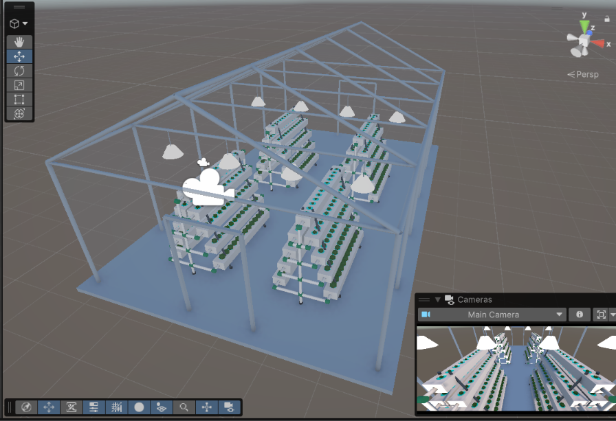

# EcoCultivo: Invernadero Hidropónico Interactivo

Aplicación educativa en 3D para **Android** que muestra un sistema de cultivo **hidropónico vertical NFT** instalado en la **azotea de un edificio**, como propuesta de agricultura urbana sustentable: aprovechar espacios de la ciudad que hoy no se usan para producir alimento con menos agua y menos suelo.

> Proyecto de la asignatura **Gráficos por Computadora** — Universidad Marista de Mérida.



---

## Qué se puede hacer en la app

| Función | Descripción |
|---|---|
| **Recorrido 3D** | Moverse libremente dentro del invernadero y alrededor de la azotea. |
| **Riego NFT por etapas** | Al encender la bomba, el agua entra por el canal superior de cada macetero, recorre el canal y baja por gravedad nivel por nivel (en zigzag). El nivel de agua sube poco a poco y se muestra el porcentaje de llenado. |
| **Día / Noche** | Cambia la iluminación: de noche se encienden las lámparas de cultivo (Spot Lights) y las ventanas de la ciudad. |
| **Reset de cámara** | Regresa a la vista inicial. |
| **Información** | Pantallas de *Objetivo del proyecto* y *Créditos*. |
| **Calidad gráfica** | *Baja* (sin post-procesado) o *Alta* (tonemapping ACES, viñeta y ajuste de color). Se elige sola según la RAM del teléfono y se puede cambiar desde el menú ≡. |

## Controles

| Plataforma | Moverse | Girar la vista |
|---|---|---|
| **Android (táctil)** | **Joystick virtual** en la mitad izquierda de la pantalla (aparece donde apoyas el dedo) | Arrastrar en la mitad derecha |
| **PC (Editor)** | `W` `A` `S` `D` / flechas | Clic derecho + arrastrar |
| **Ambos** | Botón **Atrás** de Android o `Esc`: regresar al panel anterior (doble pulsación en el menú para salir) | |

## Requisitos

- **Unity 6.6** (`6000.6.3f1`) con **Universal Render Pipeline 17.6**
- Módulo **Android Build Support** (API mínima 26, IL2CPP)
- Input System en modo **Both**

## Cómo abrir el proyecto

1. Clonar el repositorio:
   ```bash
   git clone https://github.com/<usuario>/EcoCultivo.git
   ```
2. Abrir **Unity Hub** > **Add** > seleccionar la carpeta clonada. La primera vez Unity regenera la carpeta `Library` (tarda unos minutos).
3. Abrir la escena **`Assets/EcoCultivo/Escenas/Escena3.unity`** y presionar ▶ Play.
4. Para generar el APK: **File > Build Settings > Android > Build**.

## Estructura del proyecto

```
Assets/
├── EcoCultivo/
│   ├── Escenas/            Escena3 (principal) y Anteriores/
│   ├── Scripts/            código de la aplicación
│   ├── Editor/             herramientas del menú "EcoCultivo" (solo Editor)
│   ├── Modelos/            modelos FBX (invernadero, maceteros, PVC, válvulas)
│   ├── Materiales/
│   ├── Texturas/
│   ├── Shaders/            Shader Graph de la lámpara emisiva
│   ├── UI/                 logotipos
│   ├── Datos/              TextosApp, EstiloUI y perfil de post-procesado
│   └── EntornoUrbano/      ciudad low-poly generada (mallas, paleta, materiales)
├── Settings/               configuración de URP (Mobile / PC)
└── TextMesh Pro/
Docs/capturas/              capturas de pantalla
PASOS_UNITY.md              bitácora de cambios y pasos en el Editor
```

## Scripts principales

| Script | Función |
|---|---|
| `SimpleTouchMove` | Cámara: joystick virtual + giro táctil, teclado y mouse. |
| `JoystickVisual` | Dibuja el joystick y el indicador de giro en pantalla. |
| `UIManager` | Navegación entre paneles con transiciones, historial y botón Atrás. |
| `InteractiveController` | Día/Noche, agua, reset de cámara, frame rate (60 en 3D / 30 en menús) y ahorro de batería. |
| `RiegoNFT` | Animación del riego canal por canal. |
| `CalidadGrafica` | Perfil de calidad Alta / Baja. |
| `AplicadorEstilo` + `EstiloUI` | Sistema visual central: paleta, tipografía, esquinas redondeadas y estados de botón. |
| `AplicadorTextos` + `TextosApp` | Todos los textos de la app en un solo archivo editable. |
| `MenuDesplegable` | Menú ≡ de la vista 3D. |
| `EstadoControlesAR` | Resalta los botones activos (agua, noche) y muestra el progreso del riego. |
| `AmbienteUrbano` | Nubes, aves, turbina eólica y ventanas nocturnas de la ciudad. |
| `BotonFeedback` | Escala al presionar y vibración corta en Android. |

## Rendimiento

Pensado para teléfonos de gama media: 60 FPS como objetivo en la vista 3D y 30 FPS en menús. No usa sombras de luces adicionales. La ciudad es una sola malla con un solo material. El post-procesado solo se activa en calidad Alta. Además, los scripts están diseñados para no generar basura de memoria (GC) en cada frame.

## Créditos

- **Alumno:** Felipe Cervera
- **Universidad:** Universidad Marista de Mérida
- **Asignatura:** Gráficos por Computadora
- **Profesor:** Luis de Jesús López Hernández
